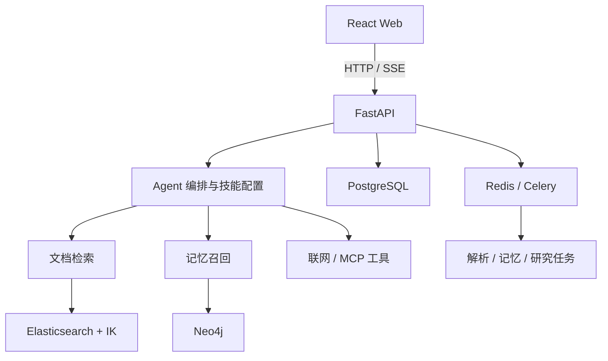

# MemoBase（知忆）

融合长期记忆的 RAG Agent。将个人文档、对话背景和外部工具接入同一问答流程，提供带来源引用的回答、跨会话记忆召回及多阶段研究报告。

## 核心能力

| 能力 | 实现 |
| --- | --- |
| 文档检索 | 父子分块、Elasticsearch 向量与 BM25 双路召回、IK 中文分词、分数归一化、加权融合和可选 Rerank |
| 长期记忆 | “对话—片段—陈述—实体”四层溯源图谱，结合规则和模型判定完成实体去重与融合 |
| Agent 编排 | 原生 Function Calling 与提示词 ReAct 双路径，知识库、记忆、联网及 MCP 工具，迭代上限、请求内结果复用和异常反馈 |
| 业务 Skills | 任务 Prompt、few-shot、内置工具白名单与知识库绑定，按对话请求挂载 |
| 异步处理 | Celery 分队列处理解析、记忆、研究和调度任务，SSE 展示回答、工具状态与引用 |
| 运行记录 | 调用轨迹、耗时、Token 与估算成本，辅助故障定位 |

业务 Skills 是数据库中的任务配置，与基于 SKILL.md 的文件技能协议不同。项目调用外部模型服务，费用和可用性由所配置的 Provider 决定。

## 架构



后端按 controller、service、repository、model 分层。PostgreSQL 保存业务数据，Elasticsearch 管理检索索引，Neo4j 存储记忆关系，Redis 承担缓存和任务队列职责；查询按用户与知识库范围过滤。

## 技术栈

- **后端**：Python 3.12+、FastAPI、Pydantic、SQLAlchemy 2、Alembic。
- **Agent 与检索**：LangChain、Elasticsearch 8.17、IK Analyzer、Neo4j 5.26。
- **任务与存储**：PostgreSQL 16、Redis、Celery。
- **前端**：React 18、TypeScript、Vite、Ant Design、Zustand。
- **开发环境**：uv、Node.js、npm、Docker Compose。

## 本地运行

需要 Python 3.12+、uv、Node.js 18+ 和 Docker。至少准备一个对话模型和一个 Embedding 模型，向量维度应与 EMBEDDING_DIMS 一致。

### 1. 获取代码并启动存储

```bash
git clone https://github.com/luren619/MemoBase.git
cd MemoBase
cp .env.example .env
docker compose up -d postgres elasticsearch neo4j redis
docker compose ps
```

Elasticsearch 通过 `docker/es/Dockerfile` 构建带 IK 的镜像。示例密码仅用于本地开发，部署时需更换。

### 2. 配置后端

```bash
cd api
uv sync
cp .env.example .env
uv run python -c "from cryptography.fernet import Fernet; print(Fernet.generate_key().decode())"
```

将生成的值填入 api/.env 的 FERNET_KEY，同时设置随机 JWT_SECRET。根目录与后端环境文件的存储账号、密码和数据库名需保持一致。

```bash
uv run alembic upgrade head
uv run python run.py
```

健康检查：<http://localhost:8000/api/health>。

### 3. 启动任务进程

在新终端进入 api/：

```bash
uv run celery -A app.celery_app.celery_app worker -l info -Q default,parse,memory,beat,research --pool=solo
```

需要定时任务时，再启动一个 beat 进程：

```bash
uv run celery -A app.celery_app.celery_app beat -l info
```

solo 便于跨平台运行；Linux/macOS 可按机器资源调整进程池、并发数和队列分工，同一部署不要重复启动 beat。

### 4. 启动前端并配置模型

在新终端进入 web/：

```bash
npm ci
npm run dev
```

访问 <http://localhost:5173>，注册账号，在模型设置中添加并测试对话模型与 Embedding 模型。重排序和联网能力需要额外配置。

建议按“上传文档 → 等待解析 → 检索 → 带引用问答 → 录入并召回记忆”的顺序检查完整流程。

## 评测

[离线评测](api/eval/README.md)包含纯向量、BM25、混合检索和混合检索加重排序等配置，输出报告和逐题明细。

```bash
cd api
cp eval/.env.eval.example eval/.env.eval
# 配置评测模型，确认使用隔离的评测数据范围后运行。
uv run python -m eval.run_eval --only retrieval
```

公开中文检索子集见 [T2Retrieval 说明](api/eval/benchmarks/cmteb_t2/README.md)。实验结果需同时记录样本规模、模型和检索配置，并保存报告与逐题明细，便于复现与比较。

## 代码导航

| 目录 | 内容 |
| --- | --- |
| api/app/core/agent/ | 工具循环、研究流程和调用轨迹 |
| api/app/core/rag/ | 文档处理、索引和混合检索 |
| api/app/core/memory/ | 记忆抽取、融合与召回 |
| api/app/services/ | 对话、技能和业务服务 |
| api/app/tasks/ | Celery 异步任务 |
| api/eval/ | 离线评测脚本、语料与标注 |
| web/ | Web 界面 |

## 部署说明

- 根目录 .env 用于 Docker Compose，api/.env 用于本地后端，两处存储配置需要一致。
- 生产部署前设置数据库密码、JWT_SECRET 和 FERNET_KEY，并将 NOTIFY_SITE_URL 改为实际 Web 地址。
- 在 web/nginx.conf 中填写自己的域名与 TLS 证书路径，memobase.example 为占位域名。
- 前端备案信息通过 web/.env.local 配置，模板见 web/.env.example；未配置时不显示备案页脚。
- 使用 docker-compose.prod.yml 时与基础 Compose 叠加，检查端口、数据卷、内存配置与 worker 队列；同一部署运行一个 beat 实例。
